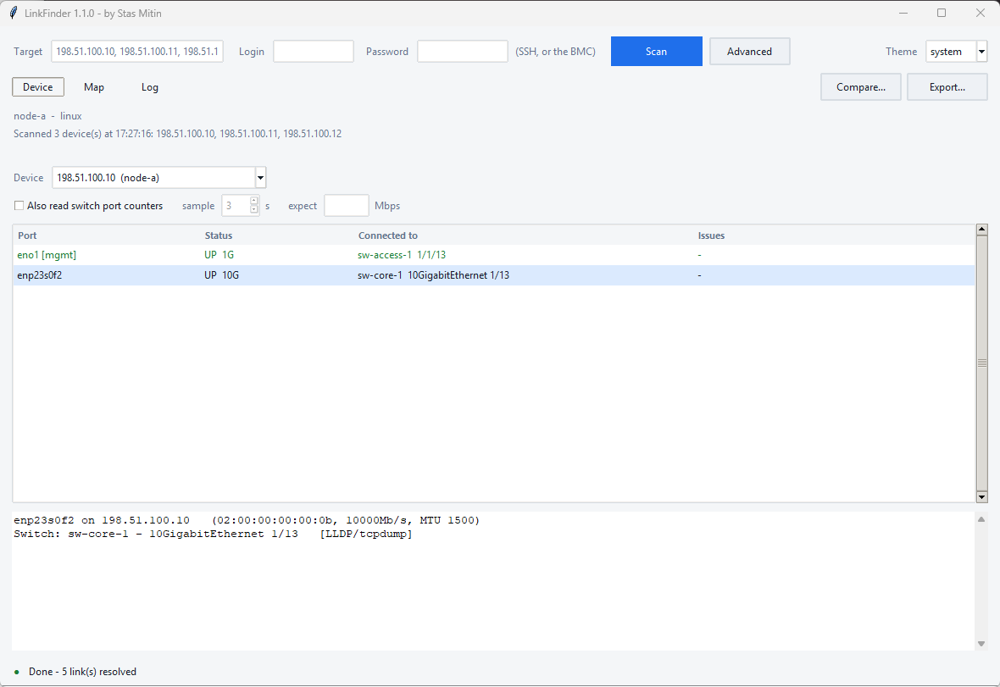
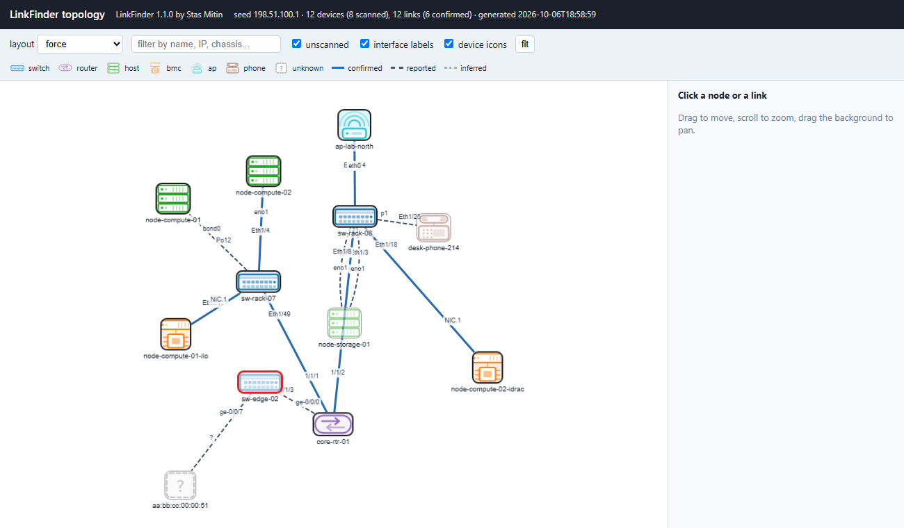
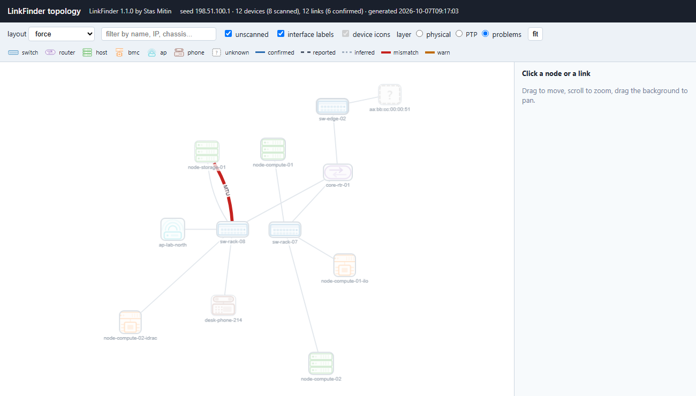
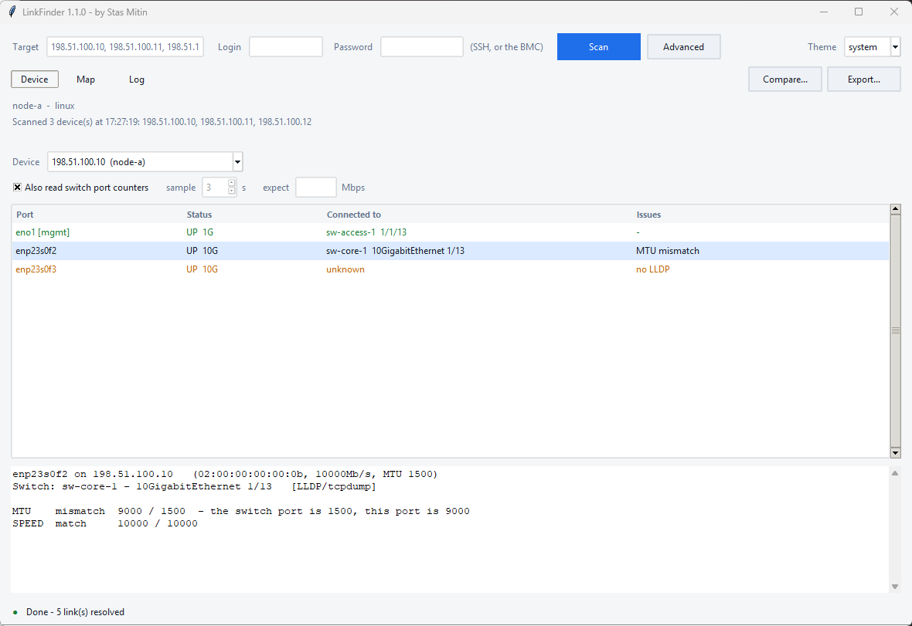

# LinkFinder

**Which switch port is this machine plugged into, what is on the other end, and is
the link actually healthy?**

Point it at an address. It works out how to ask - SSH, Redfish, SNMP, the switch
itself - gets the answer, checks the two ends against each other, and draws the
result. Nothing is installed on the target. No agent, no server, no database.

```bash
linkfinder 198.51.100.10 -u root -p secret
```

A machine that does not share that password carries its own, ssh-style - and a
target that cannot be an address is named and skipped rather than reported as
unreachable:

```bash
linkfinder 198.51.100.10,root@198.51.100.11,admin:other@198.51.100.12 -u root -p secret
```

```text
TARGET         LOCAL PORT   SWITCH       SWITCH PORT             VLAN  VIA              CHECKS        PTP
-------------  -----------  -----------  ----------------------  ----  ---------------  ------------  ------------------
198.51.100.10  eno1 [mgmt]  sw-access-1  1/1/13                  100   LLDP/networkctl  -             -
198.51.100.10  enp23s0f2    sw-core-1    10GigabitEthernet 1/13  -     LLDP/tcpdump     mtu/speed ok  SLAVE dom 24 +0ns
198.51.100.10  enp23s0f0    -            -                       -     -                -             MASTER dom 24 +0ns
198.51.100.10  enp23s0f1    -            -                       -     -                -             -
```

Four cables, four answers. Two went to switches. One is a direct cable to another
server, found through PTP because there is no LLDP and no switch in the path. One
is dark, and the row says so rather than being left out.



## It draws the site, too

Give it a starting point and it walks outward, then writes a single HTML file you
can open from disk - no web server, no CDN, no internet.

```bash
linkfinder --topology 198.51.100.1 -u admin -p secret \
    --topology-json site.topology.json --topology-html site.topology.html
```



A bond is one link on the map, not four unrelated cables. A device nobody can log
into is still on the map. Line style carries how sure we are.

The same graph carries three layers. **Physical** is the picture above.
**PTP** colours each device by its IEEE 1588 port state and marks the
grandmaster, so the clock tree is visible at a glance. **Problems** dims
everything that is fine and leaves only the links with a verdict:



On a healthy network that view is nearly empty, which is the point. Clicking a
link explains it - every check, both sides' values, and the evidence.

## And tells you what is wrong with a link

Both ends are compared wherever both ends can be reached - MTU, VLAN, speed, which
aggregation each side thinks it is in, whether spanning tree is forwarding the
port, and what transceiver is in each socket. A verdict needs both sides: one side
known and the other not is reported UNKNOWN, never as a match and never as a fault.

```text
MTU     mismatch  9000 / 1500    - one side sends up to 9000, the other accepts 1500
VLAN    match     84 / 84
LACP    warn      bond0 / none   - this end is in bond0, the switch port is not in
                                   any aggregation we can see
OPTICS  mismatch  10G-LR, 1310 nm / 10G-SR, 850 nm
                                 - single-mode against multimode, the fibre types
                                   do not meet
STP     warn      blocking       - the link is up but spanning tree has it blocking,
                                   so it carries no traffic
```

A switch port's MTU is a ceiling and a host's is a setting, so 1500 facing 10240
is not a fault. Reach is read and shown but never judged - a 10 km optic on a 2 m
patch lead is normal. Checks that would fire on healthy networks train people to
ignore the column.

Opt in to a port health read and the switch's own counters are sampled twice, so
only errors that actually moved during the sample count as evidence. Five thousand
old errors and none new is a healthy port, and it says so.



## And whether anything changed since last time

```bash
linkfinder --diff monday.topology.json tuesday.topology.json
```

```text
LINK MOVED:
  sw-access-1 Eth1/2 - node-a eno1 (was sw-access-1 Eth1/1 - node-a eno1)

DEVICE CHANGED:
  node-c
      ptp grandmaster on eno1    020000.fffe.000001 -> 020000.fffe.000077
```

---

*Idea, design and architecture by Stas Mitin. MIT licensed - see [LICENSE](LICENSE).*

Full reference, every GUI field and every flag: **[DOCUMENTATION.md](DOCUMENTATION.md)**.

## And the phones nobody else counts

A lab machine has a second fan-out no network protocol will tell you about: the
handsets, console cables and adapters on its USB ports. They go on the map as
what they are - a USB link, never an Ethernet one - coloured by generation:
USB 3 blue, USB 2 black, USB 1 plain.

```bash
linkfinder --topology 198.51.100.10 -u root -p secret --adb \
    --topology-json site.topology.json --topology-html site.topology.html
```

```text
DEPTH  DEVICE                KIND        STATE    MANAGEMENT IP
-----  --------------------  ----------  -------  --------------
0      nuc1                  host        scanned  198.51.100.10
1      ONEPLUS A5000 (aaa1)  phone       scanned  -
1      ONEPLUS A5000 (bbb2)  phone       scanned  -
1      FT230X Basic UART     serial      scanned  -
1      USB 10/100/1000 LAN   peripheral  scanned  -
```

Reading the bus is free and always happens. Asking `adb` for the model is
`--adb`, and opt-in, because running it may start an adb server that was not
there before. Four identical phones is normal, so a repeated model carries its
serial; a console cable is told apart from a slow phone; and when a host cannot
be reached its handsets are `UNKNOWN`, not unplugged - "twenty phones
disconnected" and "one NUC stopped answering" are very different mornings.

## And which physical box it is

An inventory is keyed by serial number, not by hostname. Every access path is
asked for one: SMBIOS on Linux, `Win32_BIOS` on Windows, `esxcli` on ESXi,
Redfish on a BMC, ENTITY-MIB on a switch. The serial goes on the **go to** line
and into the filter, so a number read off a label finds the device.

A board that answers `To Be Filled By O.E.M.` or `Default string` is reported
as having no serial rather than being given a fake one - accepting those would
merge every machine of that model into a single node.

## And what the inventory says should be there

```bash
linkfinder --topology 198.51.100.1 -u root -p secret --netbox --setup-tag dio
```

Looks each scanned device up in NetBox by the serial it just read and reports
only the disagreements: a box swapped for another at a documented address, a
device that moved, one NetBox calls retired that answered anyway, one it has
never heard of. Five verdicts, worst first, each with its evidence - including
`NOT_VERIFIED`, because "we could not tell" has to be sayable or every gap in
the evidence becomes an accusation that the documentation is wrong.

Setups come from the NetBox tags you name - nothing is a Setup until you say so
- and picking one on the map shows the bench together with the shared switch it
hangs off.

**It reads and never writes.** The corrections it finds go to a file a person
applies; creating records is IT's job, not a side effect of a scan.

## Where it came from

It replaces and merges two narrower tools:

| Old tool | What it did | Where it stopped |
|---|---|---|
| `check_port.py` / `LLDP_Checker.exe` | SSH to a Linux host, `tcpdump` LLDP for 60 s on the interface holding the management IP | needed `tcpdump`; one interface only; LLDP only; text parsing; one host per run |
| `read_ipmi_port.py` | Redfish LLDP from the BMC | Supermicro and HPE only; one host per run |

## What it does differently

1. **A ladder, not one method.** Each target is tried cheapest-first and stops as soon as
   it has an answer. A host running `lldpd` answers in under a second instead of waiting
   60 s for a capture.
2. **It works where `tcpdump` does not.** The last rung ships a small raw-socket sniffer
   over SSH and runs it with the target's own `python3`. Nothing has to be installed.
3. **Every interface, not just the management one.** `bond0.3674` is resolved through
   `/sys/class/net/*/lower_*` down to the real physical legs, so you get one row per
   cable — which is what a bond hides.
4. **CDP as well as LLDP.** Cisco-only switches were previously invisible.
5. **One binary decoder.** Every capture path (tcpdump, tshark, the raw sniffer, pktmon,
   pktcap-uw) returns pcap/pcapng frames that go through a single LLDP/CDP decoder, so
   there is no regex-over-`tcpdump`-text to break.
6. **The switch side.** For gear you cannot log into — RUs, PDUs, UPSs, appliances — it
   asks the switch instead, over SNMP (LLDP-MIB + the forwarding table) or the switch CLI.
7. **Batch + machine-readable.** Many targets in parallel, table / JSON / CSV output.

## Access paths

| Target | How it is interrogated |
|---|---|
| Linux (any distro) | `lldpctl` → `networkctl lldp` → `lldptool` → `tcpdump` → `tshark` → raw-socket sniffer |
| SUSE / PW nodes | the same, plus `toolbox` when `tcpdump` only exists inside it |
| ESXi | `vim-cmd hostsvc/net/query_networkhint` (CDP **and** LLDP), then `pktcap-uw` |
| Windows | `pktmon` → pcapng, locally or over OpenSSH |
| BMC | Redfish: standard `Port.Ethernet.LLDPReceive`, then an OEM table (Supermicro, HPE iLO, Dell iDRAC, Lenovo XCC, Inspur, Ampere), then a generic hunt for any chassis-id/port-id object |
| Anything else | switch side: SNMP LLDP-MIB, CDP-MIB and the bridge forwarding table; or the switch CLI |

## Install

```bash
pip install -r requirements.txt     # paramiko, requests, urllib3
```

A clone has no vendor table: `linkfinder/assets/oui.gz` is built, not kept
in the repository. Without it the tool still works, but no device is
attributed to a maker, and the map draws a device it could not reach as a
question mark instead of as its hardware.

```bash
python tools/make_oui.py            # fetches the IEEE registry, writes oui.gz
```

This is the only step that touches the network. The tool itself never does.

SNMP needs nothing — the SNMPv2c client is hand-rolled on the standard library.

### Running it from Linux

There is no installer and nothing to build. Clone the tree and run the module:

```bash
python3 -m linkfinder --help
python3 -m linkfinder 198.51.100.10 -u root -p secret
```

Proven on Ubuntu 22.04 with the distribution Python 3.10:

| Path | What it needs |
|---|---|
| SNMP: switch side, topology, port health, MAC lookup | **nothing** - the SNMPv2c client is written against the standard library |
| SSH to hosts, Redfish to a BMC | `pip install paramiko requests` |
| The window | `apt install python3-tk` (RHEL: `python3-tkinter`) |

All test suites pass there, an SNMP scan resolves a MAC to a real switch port,
and with paramiko in a virtualenv the SSH path returns PTP state, optics and
card temperature exactly as it does on Windows.

Without paramiko the SSH path does not crash: it reports
`paramiko is not installed (pip install paramiko)`, and every SNMP path carries
on working.

`tkinter` is the one thing pip cannot supply - it ships with the distribution's
Python, not from PyPI. **The window itself has not been run from Linux here**:
the hosts available had no tkinter or no display. Its logic is covered by
`tests/test_gui.py`, which drives a real window and skips cleanly where there
is no display, but those runs were on Windows.

The host's own neighbour cache is read with `ip` rather than `arp`, because
net-tools is absent from plenty of minimal installs and containers while `ip`
is always there. `arp` stays as the fallback for older boxes, and Windows keeps
using it outright.

#### A single-file binary, if you want one

`dist/*.exe` are Windows builds and will not run on Linux. `build.sh` makes a
Linux one:

```bash
pip install pyinstaller
./build.sh
./dist/linkfinder --help
```

It is the twin of `build.ps1`: the site-reference gate first, then every test
suite, then packaging. The window is packaged only when `tkinter` imports,
because a binary built without it would fail at the moment someone opened it.
Without PyInstaller the script still runs every check and says plainly that
it packaged nothing.

To package by hand instead:

```bash
pyinstaller --noconfirm --onefile --name linkfinder \
  --add-data "linkfinder/assets:linkfinder/assets" cli_entry.py
```

The separator in `--add-data` is a colon on Linux and a semicolon on Windows.
A binary is tied to the glibc of the machine that built it, so build it on the
oldest distribution you intend to run it on.

## Usage

```bash
# one Linux host, everything auto-detected
python -m linkfinder 10.70.9.93 -u root -p secret

# a BMC
python -m linkfinder 10.70.9.40 --bmc-user ADMIN --bmc-password secret -m bmc

# a whole rack, 8 at a time, into a CSV inventory
python -m linkfinder --targets-file hosts.txt -u root -p secret --csv rack.csv

# something you cannot log into: ask the switches instead
python -m linkfinder 198.51.100.13 -m switch --switch 10.70.244.30 --community public \
    --mac aa:bb:cc:dd:ee:11

# switch side as a cross-check on a host you CAN log into - it reads the MACs itself
python -m linkfinder 10.70.129.27 -m switch -u root -p secret --switch 10.70.244.30

# old LLDP_Checker behaviour: management interface only
python -m linkfinder 10.70.9.93 -u root -p secret --mgmt-only

# the window
python -m linkfinder --gui
```

Useful flags: `-t/--seconds` capture window (default 65, LLDP ticks every 30 s),
`--iface` to restrict interfaces, `-j` parallel targets, `-w` all columns,
`--json`, `--csv -`, `-q` for results only.

Exit code is `0` if at least one link resolved, `1` if none did.

## Pointing it at a switch

Give it a switch instead of a host and it logs in, works out the NOS and prints that
switch's whole neighbour table - one row per switch port and what is on the other end:

```bash
python -m linkfinder 10.70.129.2 -u admin -p secret
```

Auto-detection handles this on its own: if the SSH target is not Linux/ESXi/Windows it is
treated as a network device. `-m switch-cli` forces it.

| NOS | detected from | neighbours read with |
|---|---|---|
| Cisco IOS / IOS-XE | `cisco`, `ios` | `show lldp neighbors detail`, `show cdp neighbors detail` |
| Cisco NX-OS | `nx-os`, `nexus` | `show lldp neighbors detail`, `show cdp neighbors detail` |
| Arista EOS | `arista` | `show lldp neighbors detail` |
| Juniper JunOS | `junos` | `show lldp neighbors` |
| MikroTik RouterOS | `routeros` | `/ip/neighbor/print detail` |
| Aruba OS-CX | `arubaos-cx`, `aruba` | `show lldp neighbor-info detail` |
| HPE/Aruba ProCurve | `procurve` | `show lldp info remote-device detail` |
| Dell OS10 | `os10`, `dell` | `show lldp neighbors detail` |
| Extreme EXOS | `extremexos` | `show lldp neighbors detail` |
| Huawei VRP / H3C Comware | `huawei`, `vrp`, `h3c` | `display lldp neighbor brief` |

An unrecognised NOS still gets every command tried in turn. Output shapes reduce to three
parsers - `Key: value` blocks, whitespace columns under a header, and RouterOS
`key=value` - so a dialect that is close to one of those usually parses without a code
change. The same table drives the MAC lookup (`show mac address-table address ...` and
its equivalents) used when SNMP is off on a switch.

## Port status and health (opt-in)

Entirely optional. Without `--port-health`, or the matching tick in the window, not one
extra SNMP request is made.

```bash
python -m linkfinder 198.51.100.1 --port-health --community <community>
```

You point it at a server and it asks **the switch that server is plugged into**, not the
server - the switch found during the scan is tried first, then anything named with
`--switch`, then the targets themselves. Name a switch directly and it is used as given.

It reads the switch port table over the SNMP transport discovery already uses and gives
each port a verdict: `UP`, `DOWN`, `DISABLED`, `DEGRADED` or `UNKNOWN`, plus whether the
port looks `USED` or a `FREE_CANDIDATE`, and how confident that is.

**An absolute counter proves nothing.** `ifInErrors = 5000` may be five years old, so the
counters are read twice a few seconds apart and only a counter that actually moved counts
as evidence. A port with thousands of old errors and none new is reported healthy; a port
whose errors grew by 37 during the sample is DEGRADED, and the reason says so.

A port with no link reports no speed. `ifSpeed` still returns a number on a dead port and
it is not a negotiated one.

## Timing and direct links

A fronthaul port is usually cabled straight into another server or a radio: no switch in
the path, no LLDP anywhere, and the ladder can only report it as unresolved. PTP is on
that cable regardless, so LinkFinder reads it.

For every port it reports the timing role - which side hands out time and which takes it,
something `ip link` cannot tell you - by reading the running `ptp4l` command lines and
then querying each instance with `pmc`. The domain and the `--uds_address` are taken off
the command line, because a plain `pmc` talks to domain 0 on the default socket and comes
back empty on a host running two instances on domain 24.

```
LOCAL PORT  SWITCH  SWITCH PORT  PTP                 PEER                      CONF
enp23s0f2   sw-core-1  10GE 1/13    SLAVE dom 24 +0ns   -                         high
enp23s0f0   -       -            MASTER dom 24 +0ns  198.51.100.11 enp101s0f3  none
```

On ports LLDP could not resolve it also listens for a few seconds for PTP frames and
decodes the sender's clock identity. That identity is an EUI-64 of the sender's MAC, so
when the far end is a machine in the same run it can be named outright - `enp23s0f0 ->
198.51.100.11 enp101s0f3`, with no switch involved and no LLDP on either side.

**How far the claim goes matters.** A PTP event frame is multicast, so hearing one proves
the two ports share a layer-2 segment, not that a cable runs between them. A direct cable
is only called likely when the hearing is one to one in both directions; anything weaker
is reported as a shared segment, and a clock belonging to no machine we scanned is printed
as the identity we actually heard. Nothing is ever called proven.

It also asks the switch, in the order of how little cooperation each route needs.
The Announce frames are read passively and cost nothing; the protocol's own
management messages (`pmc`) are a question anyone on the segment may ask, with no
login and no community; and SNMP RFC 8173 PTPBASE-MIB is tried where the device
publishes it. Whichever answers is named, and a device that stays silent on one
route is not assumed silent on the others.

That is how a switch gets named rather than printed as a number. A boundary clock
builds its clock identity from the same chassis MAC it publishes over LLDP, so a
grandmaster already on the map can be matched to it - `025566.fffe.000001` becomes
the switch your servers were plugged into all along, with its clock class, time
source and distance in hops beside it.

Support for the SNMP route is genuinely patchy. A switch that publishes nothing is
reported as publishing nothing, never as broken, and the passive read keeps
working regardless. The SNMP route is covered by tests but has not yet been run
against hardware that implements the MIB.

It also assembles the clock tree. Ports are grouped by domain, and a grandmaster
that is one of our own ports is called an island - a server feeding a radio over
a point-to-point link is the grandmaster of that segment by design, not by
accident. Two grandmasters that are *not* ours under one domain number is a
split domain, and gets said once:

```text
PTP, domain 24
  grandmaster 025566.fffe.000001  (sw-core-1, class 6)
      server1 enp23s0f2   SLAVE, offset -3 ns, path delay 9 ns, 1 step(s)
  grandmaster 02aabb.fffe.000002  (class 6)
      server3 enp23s0f0   SLAVE, offset +3 ns, path delay 21 ns, 1 step(s)
  island: server1 enp23s0f0 is the grandmaster of its own segment
  SPLIT DOMAIN: domain 24 follows 2 different grandmasters that are not ours
```

Everything shown is a named IEEE 1588 field, not our invention - `domainNumber`,
`portState`, `offsetFromMaster`, `meanPathDelay`, `clockClass`, `timeSource` -
read from the standard data sets so it works on anything that speaks 1588, not
only on linuxptp. A value we have no word for is printed as the value.

This costs two cheap commands per host and runs by default. `--no-ptp` turns it off.

## Topology discovery

Give it a seed device and it walks outwards along LLDP/CDP, building a graph:

```bash
python -m linkfinder --topology 10.70.129.27 -u admin -p secret \
  --max-depth 2 --max-devices 25 --scope 10.70.0.0/16 \
  --topology-json site.topology.json --topology-html site.topology.html
```

```
DEPTH  DEVICE       KIND    STATE         MANAGEMENT IP  CHASSIS
0      delta        host    scanned       10.70.129.27   -
1      sw-lab-1     switch  scanned       10.70.244.30   aa:bb:cc:dd:ee:01
1      sw-edge-1    switch  out-of-scope  10.78.94.1     aa:bb:cc:dd:ee:02
2      sw-access-1  switch  unscanned     -              aa:bb:cc:dd:ee:03
```

**Identity is the chassis id, not the address.** One device wearing ten VLAN addresses is
one node: as soon as a chassis id arrives for a node first seen by IP the node is re-keyed
and the addresses collect in `mgmt_ips`. Two different chassis ids on one address stay two
devices. Merging never destroys what is already known - addresses and sources are unioned,
the first and last sighting widen, the more informative name or model wins, and a later
failure cannot overwrite an earlier success.

**Several seeds, and no asking twice.** `--topology` takes a list, and in the window
every address in the Target field is a seed. Press Generate after a Scan and the devices
that scan already interrogated go straight onto the map - the walk starts from their
neighbours instead of asking them again:

```bash
python -m linkfinder --topology 10.70.129.27,10.70.129.28 --max-depth 2
```

A seed may carry its own login, the same way a scan target may:
`--topology root@10.70.129.27,admin:secret@10.70.244.30`.

**Depth.** The seed is depth 0. At `--max-depth N` the devices at depth N are still
interrogated, but their neighbours are recorded without being queued.

**Limits.** `--max-depth`, `--max-devices` and `--scope` are always in force. Scope only
restricts who we *connect to*: a neighbour outside it is still drawn, marked
`out-of-scope`.

**Confirm by default.** Between levels it asks:

```
Found 6 new network device(s) at depth 1:
   10.70.244.30     sw-lab-1
Add and scan discovered neighbours? [y/N]
```

`--auto-discover` is the explicit opt-out and is never the default.

**Nothing is a dead end.** A neighbour with no management address still becomes a node,
marked `unscanned`; a device that refuses the login becomes `unreachable` with the reason
attached; neither stops the rest of the walk. Only management addresses that a discovery
protocol actually reported are followed - this is not a subnet scanner.

**Links are deduplicated and graded.** A cable reported from both ends is one edge marked
`confirmed`; seen from one end only it is `reported`; derived from a forwarding table it
is `inferred`.

### The JSON, and the picture

Discovery writes the JSON; the renderer only ever reads it, so the same file can feed
another tool:

```bash
python -m linkfinder --render-topology site.topology.json site.topology.html
```

```json
{
  "schema_version": 1,
  "generated_at": "2026-10-05T16:21:17",
  "seed": "10.70.129.27",
  "nodes": [ { "id": "chassis:aa:bb:cc:dd:ee:01", "kind": "switch", "state": "scanned",
               "mgmt_ips": ["10.70.244.30"], "sources": ["snmp"] } ],
  "edges": [ { "a": "...", "a_iface": "1/1/28", "b": "...", "b_iface": "21",
               "confidence": "confirmed", "protos": ["LLDP"] } ]
}
```

The HTML is one self-contained file - the topology, the device drawings and
`cytoscape.min.js` are all embedded, so it opens from disk with no web server and no
internet. Zoom, pan, draggable nodes, four layouts, a filter box, solid/dashed/dotted
links by confidence, interface names at each end of every link, and a click-through panel
showing every field. The library lives in `linkfinder/assets/` with its MIT licence.

Each device is drawn as what it is rather than as a coloured blob: a rack switch with a
port grid, a stack of server units, a router, a management board, an access point, a
desk phone, or a dashed box with a question mark when the kind could not be worked out.
The drawing carries the kind, the border carries the state - black for scanned, red for
unreachable, dashed and faded for anything the crawl never opened. Untick **device
icons** in the toolbar to drop back to the plain shapes, which redraw faster on a very
large map.

The icons are original line art in `linkfinder/assets/icons/`, one SVG per kind, with an
`__ACCENT__` placeholder the renderer fills with the kind colour before embedding it as a
data URI. No vendor stencil set is redistributed. Redraw or restyle them with
`python tools/make_icons.py`.

In the window: switch to **Map**, set the limits, then **Generate**. **Open**
shows the last one, **Compare...** reports what moved since a saved scan.

## It can remember switches - if you ask it to

Off by default: without `--learn` the tool writes nothing to disk at all.

With `--learn`, every management address seen in an LLDP/CDP frame, plus the neighbours
any SNMP-reachable switch names (`lldpRemManAddrTable`), is written to
`~/.linkfinder-switches.json`, and later runs re-query everything known without being
told `--switch` again:

```
  remembered a new switch: 10.70.129.2
  plus 2 remembered switch(es): 10.70.244.30, 10.78.94.1
switch side: asking 10.70.244.30, 10.78.94.1
```

```bash
python -m linkfinder ... --learn            # record and reuse (otherwise nothing is kept)
python -m linkfinder --list-switches        # what it knows, and whether SNMP answered
python -m linkfinder --forget-switches      # wipe it
python -m linkfinder --forget-switches IP   # drop one
```

The window has the same two buttons and an unticked "remember switches it finds" box.

A switch that did not answer SNMP is remembered too, marked as such, and skipped for 24 h
so it costs no time - but it still appears in the list and is still used by the switch-CLI
fallback when `--switch-user` is given.

The SNMP community is a credential and is **not** written even with `--learn`; add
`--remember-credentials` if you want the working community stored per switch. The file is
plain JSON, lives in your home directory and is in `.gitignore`; delete it to start over.

Note that one switch can be learned under several addresses: a router-on-a-stick with many
VLAN interfaces advertises whichever address faces the link in question.

## Secrets and what is written to disk

The code contains no addresses and no credentials, and that is deliberate - everything
site-specific is supplied at run time. Three places can hold real values, all of them
outside the repository and all in `.gitignore`:

| file | holds | written when |
|---|---|---|
| `~/.linkfinder.json` | your usernames and passwords | only by you, by hand |
| `~/.linkfinder-switches.json` | switch addresses and names | only with `--learn` |
| the same file | SNMP communities | only with `--learn --remember-credentials` |

Prefer the environment variables over the file if you would rather not have a password
on disk at all. Nothing is ever sent anywhere; the tool only talks to the targets you name.

Before committing: no lab address, no hostname and no password belongs in the tree. Every
address, MAC and device name in the tests and in this file is rewritten or invented on
purpose - none of them point at real equipment.

## Defaults file

`~/.linkfinder.json` so credentials are not retyped (keep it out of any repo):

```json
{
  "user": "root",
  "password": "...",
  "bmc_user": "ADMIN",
  "bmc_password": "...",
  "community": "public",
  "switches": ["10.70.9.1", "10.70.9.2@othercommunity"],
  "switch_user": "admin",
  "switch_password": "..."
}
```

`LINKFINDER_USER`, `LINKFINDER_PASSWORD`, `LINKFINDER_BMC_USER`,
`LINKFINDER_BMC_PASSWORD` and `LINKFINDER_COMMUNITY` are also read. The command line
wins over the environment, which wins over the file.

## Reading the output

```
TARGET         LOCAL PORT  SWITCH  SWITCH PORT            SWITCH IP      VLAN  VIA                   CONF
10.70.129.27  ens3f3np3   sw-lab-1  10GigabitEthernet 1/1  10.70.244.30  -     LLDP/toolbox-tcpdump  high
10.70.71.218  oam         sw-access-3  1/1/30                 -              -     LLDP/networkctl       high
198.51.100.13   -           sw-lab-1  10GigabitEthernet 1/4  10.70.244.30  100   FDB/snmp-fdb:...      low
```

`SWITCH IP` is the switch's own management address, taken from the LLDP Management
Address TLV — so the next step (log in, or query it over SNMP) needs no lookup. Not every
switch advertises it; `networkctl` also does not expose it, so the column can be empty
even when the port is known.

`SWITCH PORT` prefers a readable name. Some switches send a bare index as the Port ID and
the real interface name only in the port description; the raw Port ID is still kept, as
`switch_port_id_raw` in the CSV and `port` in the JSON.

`CONF` is `low` when the answer came from a forwarding table on a port that is carrying
many MACs — that is an uplink, and the device is further downstream, so the port shown
is not the one the cable is in. `VIA` always names the method, so every row can be
traced back to how it was obtained.

## Things worth knowing

- Auto-detection asks `/redfish/v1` **before** trying SSH, because a BMC usually also
  listens on port 22 for its IPMI shell and would otherwise swallow the target. If SSH is
  tried anyway and refuses the credentials, a host that answers Redfish is retried as a BMC.
- A capture waits for the switch to send; LLDP defaults to one frame every 30 s, which is
  why the default window is 65 s. Nothing is sent by us.
- `tcpdump`/`pktcap-uw` and the raw sniffer need root (or sudo) on the target.
- `--no-enable-lldp` stops the tool from PATCHing a BMC whose LLDP receiver is off. By
  default it does enable it — and says so in the log — because otherwise Supermicro and
  iLO return nothing.
- On Windows, `pktmon filter remove` clears **all** pktmon filters on that machine.
- Supermicro needs `SFT-OOB-LIC`/`SFT-DCMS-SINGLE` and HPE needs iLO Advanced for the
  Redfish LLDP data; without the licence the BMC answers 403 and the tool says so.

## Tests

No lab needed — the decoders and every text/JSON parser are checked against synthetic
frames and real-world captures of command output, and the SNMP codec against a fake
agent on loopback:

```bash
python tests/test_decode.py      # LLDP/CDP frames, pcap and pcapng
python tests/test_snmp.py        # the SNMPv2c codec, against a fake agent
python tests/test_parsers.py     # every text and JSON source we read
python tests/test_store.py       # the remembered-switch file
python tests/test_switchcli.py   # one sample of real output per NOS
python tests/test_topology.py    # identity, merging, edge confidence
python tests/test_crawl.py       # loops, depth, limits, scope, failures
python tests/test_render.py      # the offline HTML page
python tests/test_port_health.py # verdicts, counter deltas, failure handling
python tests/test_ptp.py         # daemon state, wire decoding, all four rungs
python tests/test_netaddr.py     # which addresses are reachable, and printing them
python tests/test_linkcheck.py   # MTU/VLAN/speed/LACP/STP, and bond folding
python tests/test_optics.py      # reading a module, and comparing two ends
python tests/test_diff.py        # what moved between two scans
python tests/test_ptp_tree.py    # islands, split domains, per-port verdicts
python tests/test_duplicates.py  # address conflicts, and the stale entry
python tests/test_targets.py     # per-host logins, and the mistyped address
python tests/test_loops.py       # rings, and not calling redundancy a loop
python tests/test_sensors.py     # card temperature, judged on its own limit
```

## Building the .exe

```powershell
.\build.ps1
```

Produces `dist\linkfinder.exe` (console/CLI) and `dist\LinkFinder-GUI.exe` (window).

The two names have to differ in more than case: Windows treats `linkfinder.exe` and
`LinkFinder.exe` as the same file, so the second build silently overwrites the first.
A running `LinkFinder-GUI.exe` also has to be closed before PyInstaller can replace it.


### An internal build with its own icon

`build.ps1` takes a brand:

```powershell
.\build.ps1              # linkfinder.exe      LinkFinder-GUI.exe
.\build.ps1 -Brand pw    # linkfinder-pw.exe   LinkFinder-PW-GUI.exe
```

The branded build reads an icon and a few strings from a local `branding/`
folder which is **not part of this project** - it is in `.gitignore` and the
site-reference check skips it, so a company logo never reaches a public
repository. `branding/README.txt` says what to put there. Missing those files
is an error, not a quiet fall back to the open build under another name.

The two builds are named apart deliberately. Windows file names are
case-insensitive, so two builds sharing one name in one folder silently leave
a single file.

`branding/brand.json` can set `"author": ""`, which drops the "- by ..." from
the window title, from a generated topology page and from `--version`. The
MIT licence, the `LICENSE` and `AUTHORS` files, the copyright line and the
header of every source file are untouched either way: the notice has to travel
with the copy, and whose name sits in a title bar is a different question.

`build.sh` is the twin on Linux and takes the same brand:

```sh
./build.sh          # linkfinder      linkfinder-gui
./build.sh pw       # linkfinder-pw   linkfinder-pw-gui
```

There is no icon in an ELF, so branding on that side is the byline alone. The
window is packaged only when `tkinter` imports, because a binary built without
it fails at the moment somebody opens it and not before.

### What a build leaves behind

Both scripts end by sorting `dist/` into one folder per audience and zipping
it, so there is a single file to hand over:

```
dist/pw/windows/     linkfinder-pw.exe, LinkFinder-PW-GUI.exe, READ ME FIRST.txt
dist/pw/linux/       linkfinder-pw, READ ME FIRST.txt
dist/pw/             README.md, DOCUMENTATION.md, LICENSE, AUTHORS, docs/
dist/LinkFinder-pw-1.1.0.zip
```

A Linux binary is built elsewhere - it cannot be made on Windows - and is
dropped into `dist/_linux/` by hand before packaging. Its own folder, because
`linkfinder` and `linkfinder.exe` are one name apart and MSYS tools resolve
the first to the second. `python tools/package.py pw` repeats the packaging
step alone. A binary is tied to the glibc it was built against.

The two front ends must carry the same icon, and twice they appeared not to
when the files were identical and the Windows icon cache was stale.
`tools/same_icon.py` hashes every image in both executables and in the source
`.ico`; the branded build runs it as a step and fails rather than shipping a
mismatch.

## Layout

| File | Role |
|---|---|
| `linkfinder/decode.py` | LLDP + CDP frame decoding, pcap/pcapng readers |
| `linkfinder/snmp.py` | SNMPv2c (BER, get/getnext/getbulk walks), stdlib only |
| `linkfinder/netaddr.py` | which addresses we can actually connect to |
| `linkfinder/targets.py` | reading a target list, and its per-host logins |
| `linkfinder/ptp.py` | timing role per port, and naming the far end of a dark cable |
| `linkfinder/ptp_snmp.py` | the switch side of PTP: RFC 8173, then vendor trees |
| `linkfinder/ptp_tree.py` | the clock tree per domain, islands and splits |
| `linkfinder/consistency.py` | when the two ends of a cable disagree |
| `linkfinder/duplicates.py` | one address with two owners |
| `linkfinder/linkcheck.py` | comparing the two ends of a link |
| `linkfinder/optics.py` | transceivers, and whether the two ends match |
| `linkfinder/lag.py` | bonds and port-channels, folded into one link |
| `linkfinder/stp.py` | whether the bridge is forwarding the port |
| `linkfinder/diff.py` | what moved between two saved scans |
| `linkfinder/port_health.py` | the opt-in switch port status and health read |
| `linkfinder/sshx.py` | paramiko wrapper, sudo without a pty, `/sys` interface model |
| `linkfinder/probe_*.py` | one module per access path |
| `linkfinder/engine.py` | path selection, fallbacks, parallel batch |
| `linkfinder/cli.py`, `gui.py` | the two front ends over the same engine |

## Using it from Claude Code

A ready-made skill ships with the repository at `.claude/skills/linkfinder/`. Clone this
repo and Claude Code picks it up automatically, so `/linkfinder <host>` or
`/linkfinder --topology <seed>` work straight away. The skill is site-neutral - it knows
how to drive the tool and nothing about anybody's network.

To make it available everywhere rather than only inside a checkout, copy that folder into
`~/.claude/skills/`.

## Licence

Copyright (c) 2026 Stas Mitin, released under the MIT licence.

Use it, change it, ship it, build on it - the only condition is that the copyright
notice travels with the code. The design and the architecture are Stas Mitin's; if this
helped you, say where it came from.

One third-party component is included: `cytoscape.min.js` 3.30.2 by The Cytoscape
Consortium, also MIT, vendored with its licence text in `linkfinder/assets/`. The device
icons are not third-party - they are drawn by `tools/make_icons.py` and covered by the
same MIT licence as the rest.
